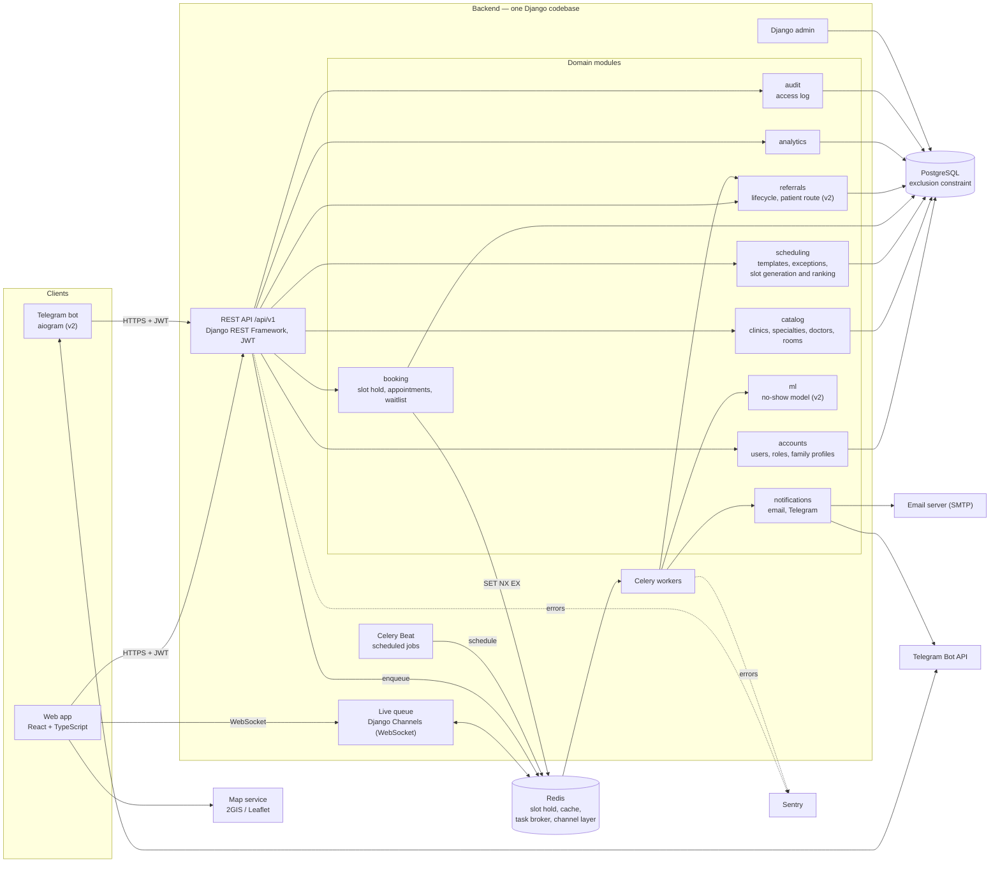
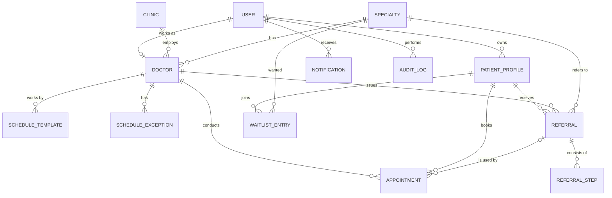
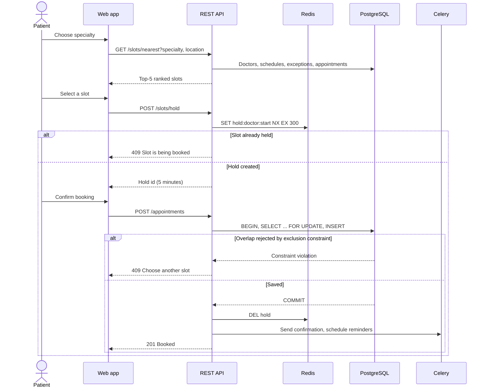
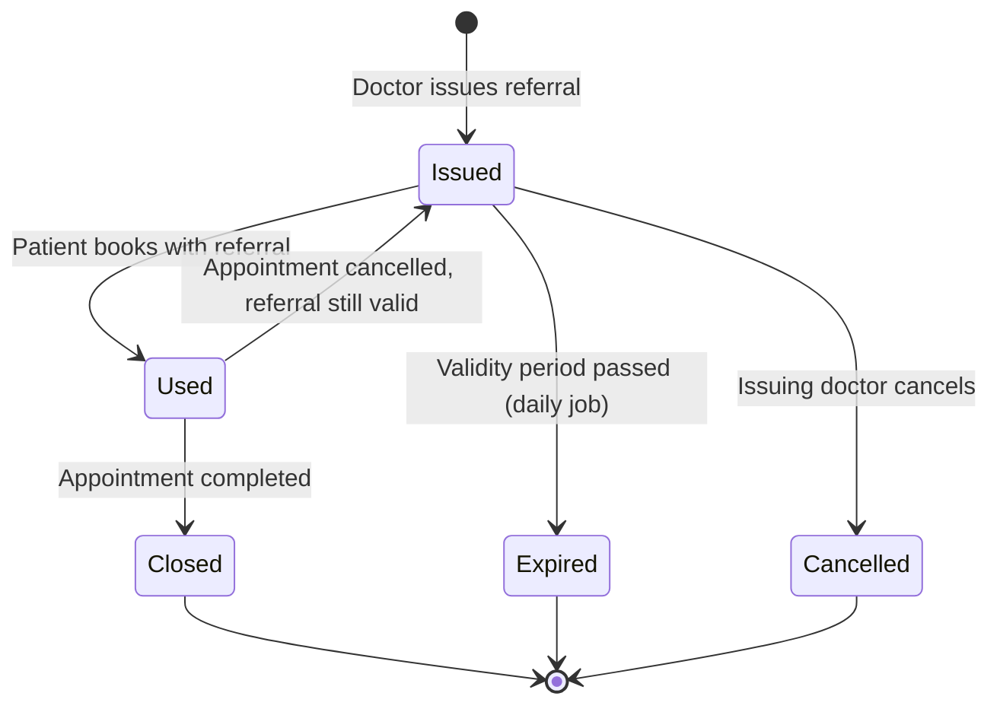

# 7. Architecture and Diagrams

Version 1.0, 23 October 2026.

Editable diagram sources (Mermaid) are in [`diagrams/src/`](../diagrams/src/), exported images in [`diagrams/png/`](../diagrams/png/). GitHub renders the diagrams below directly from the source.

| Diagram | Source | Image |
|---------|--------|-------|
| System context | `diagrams/src/context.mmd` | `diagrams/png/context.png` |
| Use case | `diagrams/src/use-case.mmd` | `diagrams/png/use-case.png` |
| Component diagram (draft) | [`component.mmd`](../diagrams/src/component.mmd) | [`component.png`](../diagrams/png/component.png) |
| Data model (ER) | [`er.mmd`](../diagrams/src/er.mmd) | [`er.png`](../diagrams/png/er.png) |
| Booking sequence | [`booking-sequence.mmd`](../diagrams/src/booking-sequence.mmd) | [`booking-sequence.png`](../diagrams/png/booking-sequence.png) |
| Referral lifecycle | [`referral-states.mmd`](../diagrams/src/referral-states.mmd) | [`referral-states.png`](../diagrams/png/referral-states.png) |

The system context and use case diagrams are prepared by Aigerim Askarova (task DIP-18); the other diagrams and this description by Yerkegali Yergali (DIP-19).

---

## 7.1 Architectural style

The system is a **modular monolith**: one Django codebase split into domain modules, plus separate processes for background jobs and real-time updates. For a team of two this keeps deployment simple (one repository, one Docker Compose file) while the modules keep responsibilities separate. The web app and the Telegram bot use the same REST API.

Technology choices are justified in [`05-technologies-backend.md`](05-technologies-backend.md) and [`05-technologies-frontend.md`](05-technologies-frontend.md).

---

## 7.2 Component diagram (draft)

| Component | Responsibility | Requirements |
|-----------|----------------|--------------|
| Web app (React) | Patient, doctor and administrator interfaces; map; live queue screen | F2–F7, F12–F14, F19, F21 |
| REST API (DRF) | Single entry point for the web app and the bot; JWT authentication; role checks | All; NFR-S1, NFR-S2 |
| accounts | Registration by IIN or phone, roles, family profiles | F1, F2 |
| catalog | Clinics, specialties, doctors, rooms, filters | F3, F6 |
| scheduling | Schedule templates and exceptions; slot generation for 14 days; slot ranking | F4, F17, F18 |
| booking | Slot hold, booking, cancellation, rescheduling, waitlist | F5, F7, NFR-D1 |
| referrals | Issuing referrals, status lifecycle, referral-gated booking, patient route | F8–F11 |
| notifications | Confirmation and reminder messages by email and Telegram | F15, F16 |
| analytics | Doctor workload, no-show rate, popular specialties | F19 |
| ml (v2) | No-show risk score for new appointments | F20 |
| audit | Log of access to medical data | NFR-S3 |
| Live queue (Channels) | Pushes queue position and estimated time over WebSocket | F13, F14 |
| Celery workers + Beat | Sending messages, reminders, referral expiry, waitlist offers, risk scoring | F7, F10, F15, F20 |
| Django admin | Back-office for clinics, doctors, schedules | F17 |
| PostgreSQL | Main data store; exclusion constraint against overlapping appointments | NFR-D1 |
| Redis | 5-minute slot hold, cache, Celery broker, Channels layer | F5, F14 |

---

## 7.3 Data model

Full attributes of each entity are in [`er.mmd`](../diagrams/src/er.mmd) and the exported image.

**Key decisions in the data model.**
- **Appointment is the central entity.** It links a patient profile, a doctor, a time range and (optionally) a referral.
- **No overlapping appointments.** `APPOINTMENT.time_range` is a PostgreSQL `tstzrange`. An exclusion constraint (`doctor_id WITH =, time_range WITH &&`, only for active statuses) makes overlapping appointments of one doctor impossible at the database level (NFR-D1).
- **Family booking.** One `USER` owns several `PATIENT_PROFILE` records; appointments and referrals belong to a profile, not to the account (F2).
- **Slots are not stored.** Free slots are generated on request from `SCHEDULE_TEMPLATE` minus `SCHEDULE_EXCEPTION`, holidays and existing appointments. This avoids keeping millions of empty slot rows in sync.
- **Referral steps** (`REFERRAL_STEP`) describe the patient route: service and result readiness time for each step (F11).
- **Audit log** stores who opened which medical record and when (NFR-S3).

---

## 7.4 Key scenarios

### Booking with double-booking protection (F4, F5, NFR-D1)

The three levels of protection work together: the Redis hold prevents most conflicts early and gives a clear message, the row lock serializes concurrent confirmations, and the exclusion constraint is the final guarantee even if the first two fail.

### Referral lifecycle (F8–F10)

Transitions follow acceptance criteria AC10.1–AC10.5 in [`06-requirements.md`](06-requirements.md). Event-driven transitions happen in the booking and appointment endpoints; expiry is a daily Celery Beat job.

---

## 7.5 Deployment

All services start with one command, `docker compose up` (NFR-M2):

| Service | Image / process | Purpose |
|---------|-----------------|---------|
| `frontend` | Nginx serving the built React app | Static files, proxy to the API |
| `backend` | Django on an ASGI server | REST API and WebSocket |
| `worker` | Celery worker (same code as backend) | Background tasks |
| `beat` | Celery Beat (same code) | Scheduled jobs |
| `db` | PostgreSQL with `btree_gist` extension | Main database |
| `redis` | Redis | Hold, cache, broker, channel layer |

Configuration comes from environment variables (see [`.env.example`](../.env.example)); no secrets are stored in the repository.

---

## 7.6 Consistency check: requirements → components → data → scenarios

| Requirement | Component | Main entities | API | Verified by |
|-------------|-----------|---------------|-----|-------------|
| F1 Registration and login | accounts | USER | `/auth/register`, `/auth/login`, `/auth/refresh` | E4 |
| F3 Catalog | catalog | CLINIC, DOCTOR, SPECIALTY | `/clinics`, `/doctors`, `/specialties` | E4 |
| F4 Nearest slot | scheduling | SCHEDULE_TEMPLATE, SCHEDULE_EXCEPTION, APPOINTMENT | `/slots/nearest` | E1, E3 |
| F5 Booking | booking | APPOINTMENT (+ Redis hold) | `/slots/hold`, `/appointments` | E2, E4 |
| F7 Waitlist | booking, workers | WAITLIST_ENTRY | `/waitlist` | E4 |
| F8–F10 Referrals | referrals, workers | REFERRAL, APPOINTMENT | `/referrals` | E4 |
| F11 Patient route | referrals | REFERRAL_STEP, APPOINTMENT | `/referrals/{id}/route` | E6 |
| F12 Doctor schedule | booking, audit | APPOINTMENT, AUDIT_LOG | `/appointments` | E4 |
| F13–F14 Live queue | Channels | APPOINTMENT | `/appointments/{id}/start`, `/finish`, `ws /ws/queue/{doctor_id}` | E4 |
| F15 Reminders | notifications, beat | NOTIFICATION | — (background) | E4 |
| F17 Administration | Django admin | DOCTOR, SCHEDULE_TEMPLATE, SCHEDULE_EXCEPTION | admin | E4 |
| F19 Analytics | analytics | APPOINTMENT | `/analytics/summary` | E4 |
| F20 No-show risk | ml, workers | APPOINTMENT.no_show_risk | — (background) | E7 |
| NFR-D1 No double booking | booking, PostgreSQL, Redis | APPOINTMENT | `/appointments` | E2 |
| NFR-S3 Audit | audit | AUDIT_LOG | — | E4 |

Every MVP requirement maps to a component, data and an evaluation in [`09-evaluation-plan.md`](09-evaluation-plan.md).
