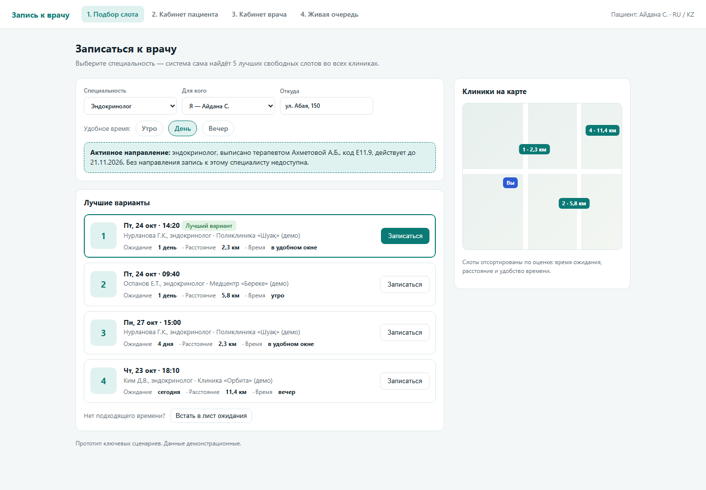
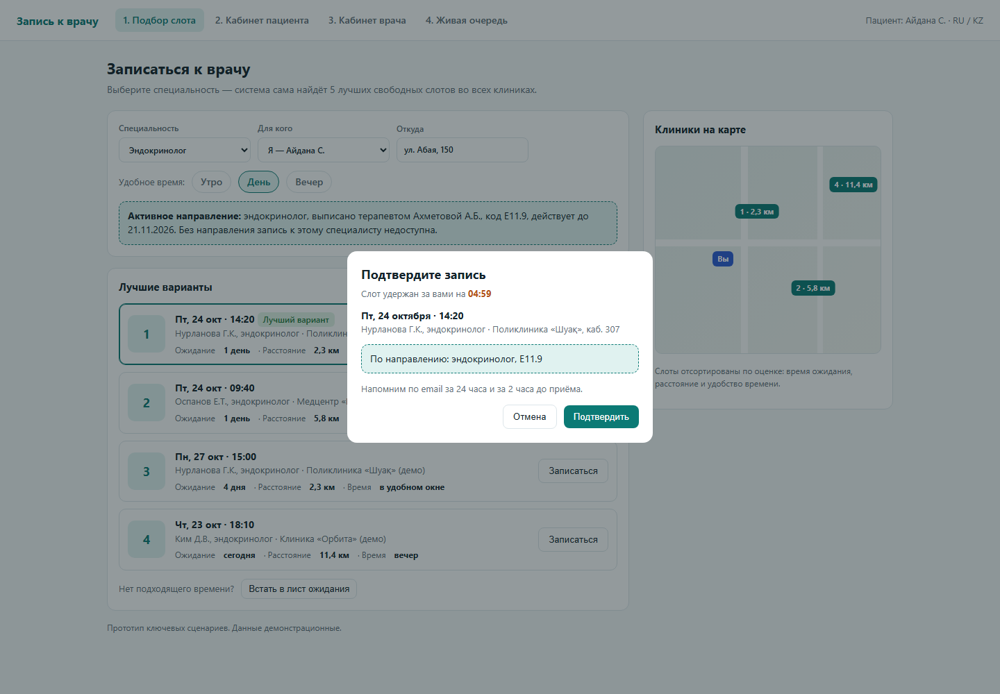
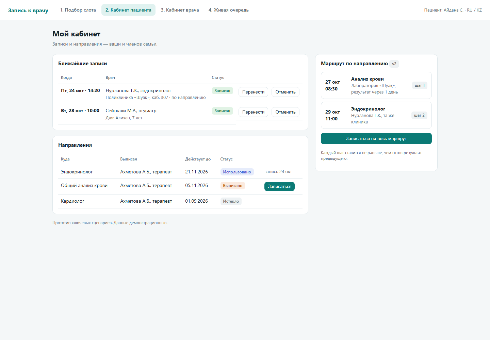
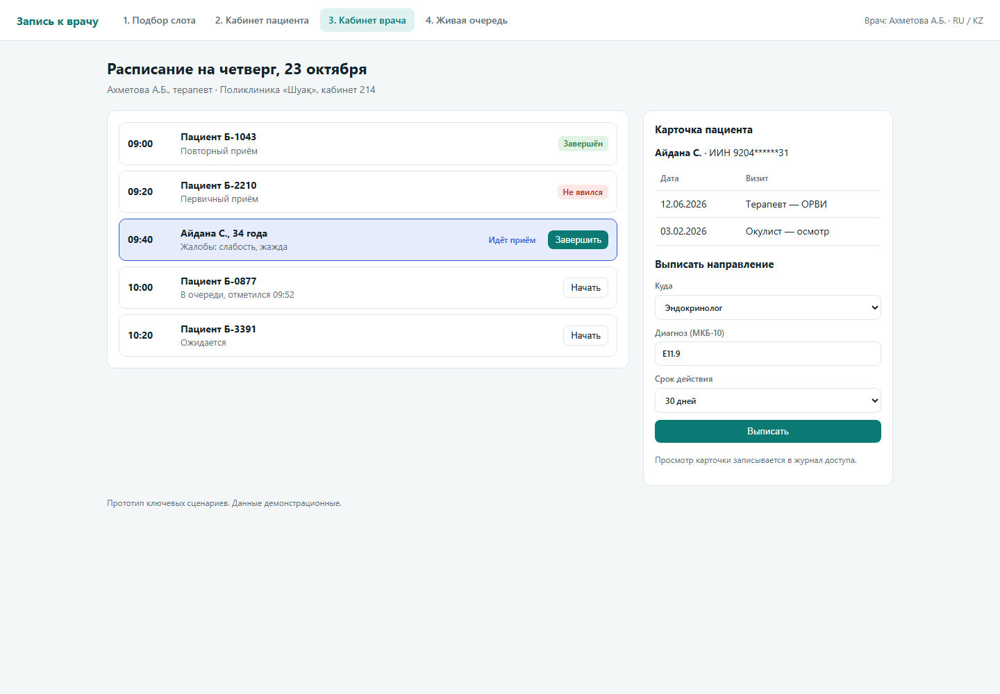
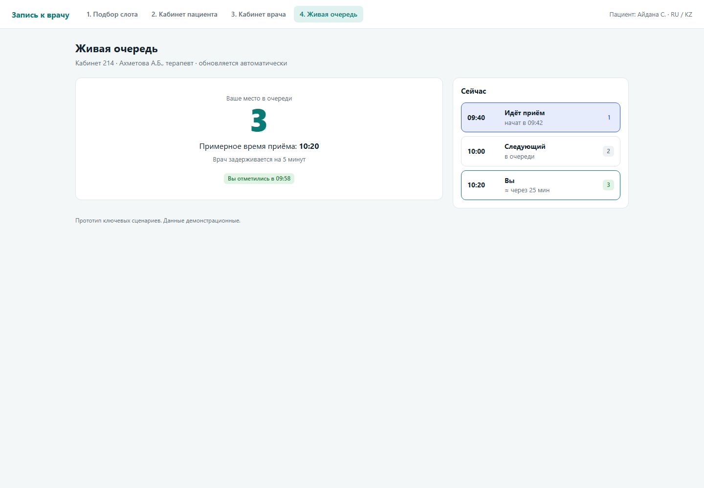
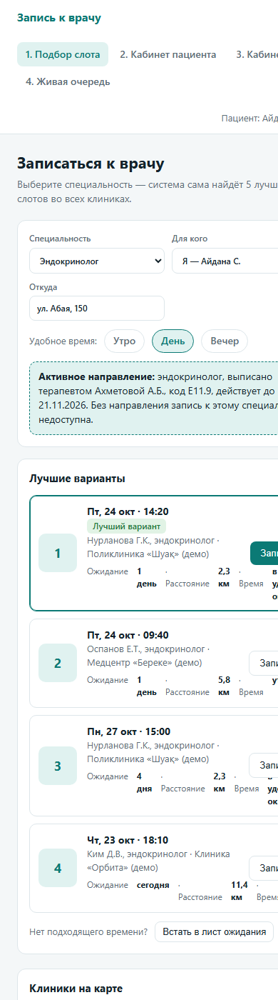

# 8. UX Prototype

Version 1.0, 23 October 2026.

The clickable prototype is a single HTML page: [`src/frontend/prototype/index.html`](../src/frontend/prototype/index.html). Open it in a browser (download the repository or the file and double-click it); screens are switched with the tabs at the top. All data on the screens are demo data.

The prototype covers the key scenarios from the use case diagram ([`07-architecture.md`](07-architecture.md)) and the MVP requirements ([`06-requirements.md`](06-requirements.md)).

## Scenario 1. Finding the nearest slot and booking (F3, F4, F5, F9)

1. The patient chooses a specialty, the person to book for (self or a family member), the starting address and a convenient time of day.
2. If the specialty requires a referral, the active referral is shown; without it booking is not available.
3. The system shows up to 5 ranked slots across doctors and clinics, each with waiting time, distance and whether the time fits the preferred window. The best option is highlighted; clinics are shown on the map.
4. If no time fits, the patient can join the waitlist.

5. After choosing a slot, it is held for 5 minutes while the patient confirms the booking. The confirmation screen shows the referral used and how reminders will be sent.

## Scenario 2. Patient cabinet: appointments and referrals (F2, F5, F8–F11)

- Upcoming appointments for the patient and family members, with "Reschedule" and "Cancel".
- Referrals with their status (*Issued*, *Used*, *Expired*) and validity date; an issued referral can be used to book directly.
- (v2) Patient route: the steps of a referral are scheduled one after another, each not earlier than the previous result is ready, and can be booked with one button.

## Scenario 3. Doctor cabinet: schedule and referral (F12, F13, F8)

- The day's schedule with statuses: completed, no-show, in progress, waiting.
- "Start" and "Finish" buttons for the current appointment.
- Patient card with visit history (IIN masked; opening the card is logged).
- Issuing a referral: target specialty, ICD-10 code and validity period.

## Scenario 4. Live queue (F14)

- The patient sees their position, the estimated time of the visit and the current state of the queue; the screen updates when the doctor starts or finishes an appointment.

## Mobile layout (NFR-U1)

The interface adapts to narrow screens; the search screen at 390 px width:

## Next steps

- Usability sessions with 5 participants on these scenarios (experiment E5 in [`09-evaluation-plan.md`](09-evaluation-plan.md)).
- Kazakh version of the texts (F21).
- Administrator screens (F17, F19) are planned with the v1 version.
